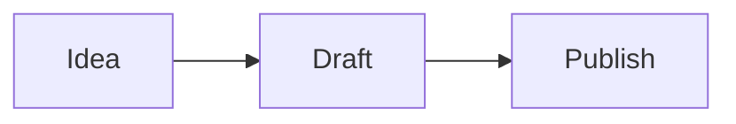

# Writing with the journal theme

Articles remain in `_posts/YYYY-MM-DD-title.md`. Existing article URLs are unchanged.
The home page shows newest articles first, grouped by year. Dates use UTC so they
do not change between the build machine and a visitor's browser.

```yaml
---
title: "A walk by the river"
date: "2026-11-01T12:00:00Z"
excerpt: "An afternoon with a camera."
tags: [摄影]
layout: photo
lang: en
# Both cover fields are optional. Omit them for a text-only entry.
coverImage: "/assets/blog/2026-11-01-river/river.webp"
coverAlt: "Reeds beside the river in afternoon light"
---
```

- Tags: `杂文` / `essays`, `游记` / `travel`, `摄影` / `photography`.
  English display labels are Essays, Travel, and Photography. Multiple tags are
  allowed. Missing tags default to Essays. Other tags cause a build error.
- `layout: article` is the default. It uses a narrow reading column.
  `layout: photo` gives Markdown figures the full page width. Text stays narrow.
- `lang`: `zh-CN` (default), `en`, or `ja`. Japanese articles use Japanese serif
  glyphs. English and Chinese text use Georgia and Noto Serif SC, with system
  serif fallbacks. Fonts are self-hosted by the Next.js build.
- A cover appears as a small timeline thumbnail and an article lead image.
  There is no home page hero or fallback cover.
- Filenames containing `_draft` appear only in development, not in the export.
- Edit your profile in `src/app/about/page.tsx`.

## Images and vector illustrations

Store compressed photos in `public/assets/blog/<post-slug>/`. Use descriptive
alt text; the Markdown renderer also uses it as the figure caption.

```markdown


```

Use WebP for photos and SVG for vector illustrations. Ordinary Markdown images
load lazily. Images keep their aspect ratio; the article does not crop photos.
The existing `scripts/convert-webp.ps1` helper needs the `cwebp` program installed.

## Equations

Write inline math as `$E = mc^2$`. Use a separate block for display math:

```latex
$$
f = \frac{bp-q}{b}
$$
```

KaTeX produces native MathML. Tables, lists, footnotes, and fenced code blocks
are supported. Wide equations, code, and tables scroll within their container.

## Mermaid

Use a fenced `mermaid` block. The browser loads Mermaid only on pages that
contain diagrams. It produces SVG and follows the selected light or dark mode.
Use `accTitle` and `accDescr` to describe a diagram for screen readers.

````markdown

````

Diagrams use Mermaid's strict security mode. Invalid diagrams keep their source
visible. With JavaScript disabled, the fenced source remains readable.

## English editions

English routes live under `/en`. Put an English translation in
`_posts/en/<original-filename>.md`. Keep the same filename as its source.

```yaml
---
title: "An English title"
excerpt: "An English summary."
lang: en
# Optional translated description of the same cover:
coverAlt: "Reeds beside the river"
---

The full English article goes here.
```

The translation inherits the original date, tags, layout, and cover image.
Translate the body and image captions; reuse the original image paths. You can
edit each language independently. The language switch keeps readers on the same
article, tag, or profile page. Metadata includes canonical and alternate-language
URLs. Untranslated articles are omitted from the English timeline. Their header
language switch goes to the English index, and no article translation link appears.

Eight English translations are included. The existing English article is reused
without a duplicate file. Review translated wording before publishing, especially
personal opinions and technical passages. Future edits to an original do not
automatically change its translation. No translation service or API key is used.

## Disqus comments

The theme is configured for the supplied Disqus site **rdcgblog.disqus.com**,
with shortname `rdcgblog`. The production workflow already uses this shortname.
No API key is needed for the embed. The canonical site defaults to
`https://njzwj.github.io`.

Readers select Load comments before a Disqus script is loaded. English and
original articles share the same thread, using the original article slug and URL.
A theme change keeps that identifier. Posting and moderation remain in Disqus.

To change settings, copy `.env.example` to `.env.local`, edit the values, and
restart the server. For deployment, set the same values in GitHub repository
Settings → Secrets and variables → Actions → Variables:

- `NEXT_PUBLIC_SITE_URL`: your published origin, if it changes.
- `NEXT_PUBLIC_DISQUS_SHORTNAME`: another registered Disqus shortname, if needed.

These are public settings included at build time. An explicitly empty local
shortname hides comments. The GitHub workflow falls back to `rdcgblog` when its
variable is unset. Remove that workflow fallback if you want to disable comments
in production. In Disqus administration, confirm your website URL and choose your
moderation policy. Local preview can verify the embed; also check a real article
on your published domain after deployment. No comments are posted by the setup.

## Preview and verify

Use Node.js 20 and the committed npm lockfile.

```sh
npm ci
npm run dev
npx tsc --noEmit
npm run build
```

The production export is in `out/`. Preview it with a static file server;
`npm start` is not compatible with Next.js static export.
